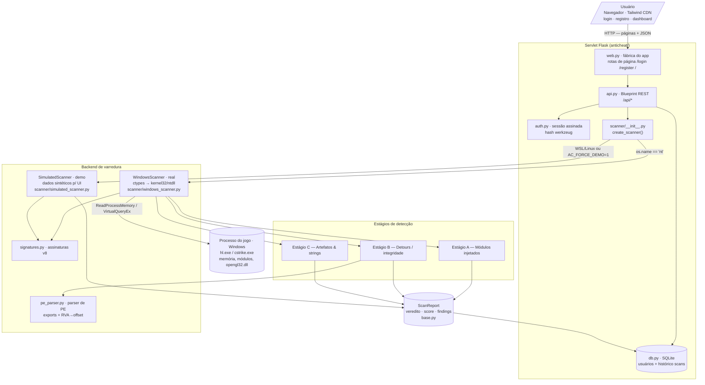

# Arquitetura do anti-cheat

Este documento descreve a arquitetura do **anti-cheat web** (Flask + Tailwind),
com diagrama em Mermaid, uma versão em ASCII para terminal e o detalhamento de
cada camada.

- Diagrama **Mermaid** (renderiza em GitHub/GitLab/VS Code): abaixo.
- Diagrama **interativo** no navegador: [`architecture.html`](architecture.html).
- Implantação e configuração: [deployment.md](deployment.md).

---

## 1. Diagrama da arquitetura



---

## 2. Versão em ASCII (terminal)

```
                          ┌───────────────────────────────────────┐
                          │        USUÁRIO (navegador)            │
                          │  Tailwind CDN · login · dashboard     │
                          └───────────────────┬───────────────────┘
                                              │  HTTP (páginas + JSON)
                                              ▼
   ┌──────────────────────────────────────────────────────────────────┐
   │                       SERVIDOR FLASK (anticheat/)                 │
   │  ┌──────────────┐  ┌──────────────┐  ┌────────────────────────┐  │
   │  │   web.py     │  │  api.py      │  │        auth.py         │  │
   │  │ rotas página │─▶│ Blueprint    │─▶│ sessão assinada + hash │  │
   │  │ /login  /    │  │ /api/*       │  └────────────────────────┘  │
   │  └──────────────┘  └──────┬───────┘                               │
   │                           │                                       │
   │              ┌────────────▼────────────┐       ┌──────────────┐   │
   │              │  db.py · SQLite         │       │   FACTORY    │   │
   │              │  usuários + scans       │       │ create_scanner│   │
   │              └─────────────────────────┘       └──────┬───────┘   │
   └──────────────────────────────────────────────────────┼───────────┘
                                                          │
                                   os.name == 'nt' ?  ┌───┴────┐
                              ┌────────────────────────┘        └──────────────────┐
                     ┌────────▼─────────────────┐                  ┌───────────────▼─────────┐
                     │  WindowsScanner (real)   │                  │ SimulatedScanner (demo)   │
                     │  ctypes → kernel32       │                  │ dados sintéticos p/ UI    │
                     │  + pe_parser + assinaturas│                └───────────────────┬───────┘
                     └────────┬─────────────────┘                                      │
                              │ ReadProcessMemory / VirtualQueryEx                     │
                              ▼                                                       │
                     ┌──────────────────────────┐                                     │
                     │  Jogo CS 1.6 (Windows)  │                                     │
                     │  hl.exe / cstrike.exe   │                                     │
                     │  módulos · memória ·   │                                     │
                     │  opengl32.dll          │                                     │
                     └──────────────────────────┘                                     │
                                                                                     │
   Estágio A · B · C  ────────────────► ScanReport (veredito, score, findings) ◄─────┘
```

---

## 3. Camadas em detalhe

### 3.1 Apresentação (browser)
- **Tailwind (via CDN) + Jinja** (`templates/`): `login.html`, `register.html`,
  `dashboard.html`, `base.html`.
- **`static/app.js`** consome a API e renderiza veredito, score, resultados por
  estágio e histórico. **`static/auth.js`** gerencia login/registro.

### 3.2 Aplicação (Flask)
- **`web.py`**: cria o app, configura secret_key/sessão, registra o blueprint e
  serve as páginas. Protege `/` com `login_required`.
- **`api.py`**: Blueprint REST (`/api/register|login|logout|me|processes|scan|
  reports`). É o único ponto que fala com o scanner e o banco.
- **`auth.py`**: registro/validação de credenciais, hash (werkzeug/PBKDF2),
  decorator `login_required` (redireciona na web, 401 na API).

### 3.3 Dados
- **`db.py`** (SQLite): tabelas `users` e `scans`. Guarda o relatório JSON de
  cada varredura para o histórico. Caminho padrão `data/anticheat.db`.

### 3.4 Varredura (o núcleo)
- **Fábrica** (`scanner/__init__.py`): seleciona o backend por SO/flag.
- **Backends**:
  - **`WindowsScanner`** (real): lê o processo do jogo usando
    `CreateToolhelp32Snapshot`, `OpenProcess`, `VirtualQueryEx`, `ReadProcessMemory`.
  - **`SimulatedScanner`** (demo): gera um `ScanReport` idêntico para testar a
    GUI sem processo do Windows.
- **Assinaturas** (`signatures.py`): lista negra de módulos, alvos de hook do
  `opengl32.dll`, strings de memória e artefatos — herdadas do anti-cheat v8.
- **Parser de PE** (`pe_parser.py`): lê exports e converte RVA→offset, usado no
  Estágio B para comparar bytes em disco × memória.
- **`base.py`**: `ScannerBase` (interface), `Finding` e `ScanReport` com o
  cálculo de veredito/score.

### 3.5 Detecção (3 estágios)
- **A — Módulos:** DLLs injetadas / fora da whitelist / nome "hex aleatório".
- **B — Detours:** `mem[0]==0xE9` (detour inline) ou bytes divergentes em
  exports do `opengl32.dll` (`wglSwapBuffers`, `glBegin`, `glEnable`, …).
- **C — Artefatos & strings:** logs em `C:\Temp\*_Debug.txt` e assinaturas na
  memória (`AIMBOT PRONTO`, `ForceWallhack`, `hk_wglSwapBuffers`, `gEngfuncs`).

---

## 4. Fluxo de uma varredura

1. O usuário autentica (cookie de sessão assinada) e clica em **Iniciar varredura**.
2. `app.js` faz `POST /api/scan` (com o `pid` do processo selecionado).
3. `api.py` chama `create_scanner()` (Windows real ou demo) e `scan(pid)`.
4. O scanner enumera módulos, parseia o `opengl32.dll`, lê memória e coleta
   artifacts/strings → monta um `ScanReport`.
5. `base.py` calcula **score** (peso por severidade) e **veredito**
   (LIMPO / SUSPEITO / HACKEADO).
6. A API salva o relatório em `scans` (histórico) e devolve o JSON.
7. `app.js` renderiza veredito, barra de ameaça, achados por estágio e
   atualiza o histórico.

---

## 5. Decisões de arquitetura

| Decisão | Racional |
|---|---|
| **Backend Python puro (ctypes)** em vez de compilar o C++ v8 | Portável, sem toolchain MinGW; mesmo efeito com menos fricção. |
| **Seleção automática do backend** | O scan real só roda no Windows; o demo permite desenvolver/testar a UI em WSL/Linux sem processo do jogo. |
| **Sessão assinada por cookie** | Sem dependência de servidor de sessão; funciona igual no Windows e WSL. |
| **SQLite** | Zero-config, arquivo local; suficiente para usuários + histórico. |
| **Assinaturas centralizadas** (`signatures.py`) | Fácil de estender/atualizar sem mexer na lógica de detecção. |
| **Scan externo (somente leitura)** | Não injeta nada; alinhado ao escopo defensivo do laboratório. |

> Diagrama interativo: abra [`architecture.html`](architecture.html) no navegador.

---

## 6. Referências

> Formatação conforme a **ABNT NBR 6023**. Versão em DOCX:
> [`referencias_abnt.docx`](referencias_abnt.docx) (gerada pelo script
> [`scripts/generate_references_docx.py`](../scripts/generate_references_docx.py)).

1. ASSOCIAÇÃO BRASILEIRA DE NORMAS TÉCNICAS. **NBR 6023: informação e documentação — referências — elaboração**. Rio de Janeiro: ABNT, 2018. 68 p.
2. ASSOCIAÇÃO BRASILEIRA DE NORMAS TÉCNICAS. **NBR 14724: informação e documentação — trabalhos acadêmicos — apresentação**. Rio de Janeiro: ABNT, 2011. 113 p.
3. ZERO-TRUST-SYNDICATE. **Anti-cheat v8: detecção client-side das técnicas do laboratório**. [S.l.: s.n.], 2026. Disponível em: `rebuild/v8/ANTICHEAT-v8.md`. Acesso em: 1 set. 2026.
4. ZERO-TRUST-SYNDICATE. **Aimbot v8: guia de calibração e estudo de prevenção**. [S.l.: s.n.], 2026. Disponível em: `doc/Aimbot-e-prevencao.md`. Acesso em: 1 set. 2026.
5. VALVE CORPORATION. **Counter-Strike 1.6** [software]. Bellevue: Valve Corporation, 2003.
6. MICROSOFT. **ReadProcessMemory function (memoryapi.h)**. 2024. Disponível em: <https://learn.microsoft.com/en-us/windows/win32/api/memoryapi/nf-memoryapi-readprocessmemory>. Acesso em: 1 set. 2026.
7. MICROSOFT. **VirtualQueryEx function (memoryapi.h)**. 2024. Disponível em: <https://learn.microsoft.com/en-us/windows/win32/api/memoryapi/nf-memoryapi-virtualqueryex>. Acesso em: 1 set. 2026.
8. MICROSOFT. **CreateToolhelp32Snapshot function (tlhelp32.h)**. 2024. Disponível em: <https://learn.microsoft.com/en-us/windows/win32/api/tlhelp32/nf-tlhelp32-createtoolhelp32snapshot>. Acesso em: 1 set. 2026.
9. MICROSOFT. **OpenProcess function (processthreadsapi.h)**. 2024. Disponível em: <https://learn.microsoft.com/en-us/windows/win32/api/processthreadsapi/nf-processthreadsapi-openprocess>. Acesso em: 1 set. 2026.
10. PALLETS. **Flask documentation**. 2024. Disponível em: <https://flask.palletsprojects.com/>. Acesso em: 1 set. 2026.
11. TAILWIND LABS. **Tailwind CSS: utility-first CSS framework**. 2024. Disponível em: <https://tailwindcss.com/docs>. Acesso em: 1 set. 2026.
12. MERMAID. **Mermaid: diagramming and charting tool**. 2024. Disponível em: <https://mermaid.js.org/>. Acesso em: 1 set. 2026.
13. PYTHON SOFTWARE FOUNDATION. **sqlite3: SQLite databases**. Python 3.10.1 documentation. 2024. Disponível em: <https://docs.python.org/3/library/sqlite3.html>. Acesso em: 1 set. 2026.
14. H J CHEATS. **Cheat para Counter-Strike** [software analisado]. 2025. Disponível em: <https://dhjcheats.com/>. Acesso em: 1 set. 2026.
