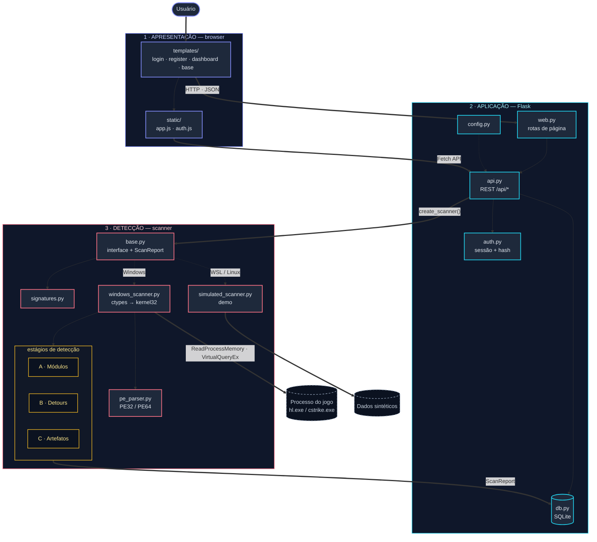

## O que foi construído

O anti-cheat web foi construído sobre uma arquitetura em três camadas que
separa, deliberadamente, a interface, a orquestração e a detecção. O
**frontend**, servido pelo próprio Flask, concentra a apresentação e a
interação do usuário; o **backend** reúne as regras de negócio, a autenticação,
a persistência e a coordenação da varredura; e o **scanner** concentra a lógica
de leitura e de análise da memória do processo do jogo. Essa separação garante
que a mecânica de detecção possa evoluir — e ser testada — independentemente da
interface, e é também o que torna possível a coexistência de dois modos de
operação, conforme descrito adiante.

### Detecção em três estágios

O núcleo da solução é composto por três estágios de detecção, herdados do
anti-cheat v8 e executados em sequência, cada um produzindo evidências
independentes:

- **Estágio A — Módulos:** enumera as bibliotecas dinâmicas carregadas no
  processo e sinaliza as DLLs injetadas, as que estão fora da lista branca
  (*whitelist*), as carregadas a partir de diretórios temporários (`temp`) e
  aquelas cujo nome apresenta aparência hexadecimal aleatória.
- **Estágio B — Detours:** verifica os *exports* do `opengl32.dll`, comparando
  os bytes presentes na memória com os bytes da imagem em disco. A presença de
  `mem[0] == 0xE9` caracteriza um *detour* inline, enquanto a divergência entre
  disco e memória indica *patch* ou modificação do código original.
- **Estágio C — Artefatos:** inspeciona artefatos em disco, como os arquivos de
  log em `C:\Temp`, e varre a memória do processo em busca de strings
  características dos cheats.

### Diagrama de componentes

### Estrutura de módulos

A organização do código acompanha diretamente a separação de responsabilidades
da arquitetura:

| Camada | Local | Componentes |
|---|---|---|
| **Backend** | `anticheat/` | `web.py` (aplicação), `api.py` (API REST), `auth.py` (sessão + hash), `db.py` (SQLite) e `config.py` (configurações). |
| **Scanner** | `anticheat/scanner/` | `base.py` (interface e modelo do relatório), `signatures.py` (assinaturas), `pe_parser.py` (parser PE32/PE64), `windows_scanner.py` (varredura real via `ctypes` → `kernel32`) e `simulated_scanner.py` (modo demonstração). |
| **Frontend** | `templates/` e `static/` | `templates/` (`login`, `register`, `dashboard`, `base`) e `static/` (`app.js`, `auth.js`). |

Por fim, o sistema realiza **seleção automática de backend** conforme o
ambiente: no **Windows**, utiliza a varredura real de memória; em ambientes
**WSL/Linux**, recorre ao modo de demonstração, o que permite desenvolver e
testar toda a interface sem a necessidade de um processo do jogo em execução.
